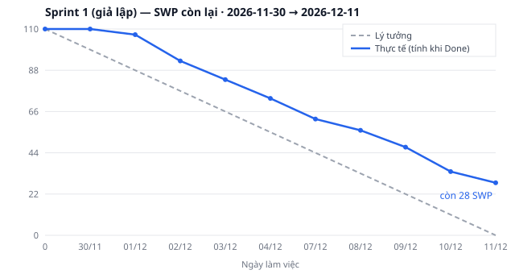

# Báo cáo tiến độ — Sprint 1 (giả lập)

Product B · Yuki Cold Chain WMS/TMS · Project: [https://github.com/users/nguhdd-3772/projects/1](https://github.com/users/nguhdd-3772/projects/1) (view "Sprint 1", "Lịch sprint")

> **Đây là sprint giả lập cho bài LAB-5.** Diễn biến từng issue là kịch bản do PL dựng để luyện báo cáo: ngày xong, câu trả lời của khách, thiết bị chưa về. Số issue, SWP và giờ là số thật của backlog. Trạng thái trên Project, tiêu chí nghiệm thu đã tick và comment trên các issue Done đều khớp với báo cáo này. Bản tóm tắt gửi khách (tiếng Nhật) ở cuối file.

## 1. Iteration

| Mục | Nội dung |
|---|---|
| Iteration | **Sprint 1** (field `Iteration` trên Project, sprint 2 tuần) |
| Thời gian giả lập | 2026-11-30 (T2) → 2026-12-11 (T6), 10 ngày làm việc. Đây là sprint đầu của giai đoạn 構築・システムテスト, kéo dài tới 2027-04-02 (lịch LAB-1) |
| Mục tiêu sprint | Nền tảng chung (mã lỗi, phân quyền, khung chính sách) + kiểm nhập chạy được transaction thật, gửi hết câu hỏi khách đang chặn, chốt cách hiểu luật giờ lái (spike) trước khi code kiểm kỳ. |
| Năng lực | Nhân sự P2 theo LAB-1 (BE 3,3 · FE 2,5 · QA 2,4 · TL 0,2 · BrSE 0,4 · UI 0,3 · Infra 0,3 người) = 9,4 người × 10 ngày × 8h ≈ 752h giờ ước lượng / sprint (1 MD = 8h như LAB-1). Sprint đầu đặt trần cam kết 56h / người (70%) để chừa dựng môi trường, onboarding. PM, Infra không nhận issue ở sprint này. Cam kết 315h, bằng 42% năng lực: chỉ kéo việc đã có spec và không bị câu hỏi khách chặn |

Giờ nhận theo vai trò (script kiểm không ai vượt trần cam kết):

| Vai trò | Giờ nhận | Trần |
|---|---|---|
| BE-1 | 47 | 56 |
| BE-2 | 55 | 56 |
| BE-3 | 47 | 56 |
| BrSE | 17 | 56 |
| FE-1 | 29 | 56 |
| FE-2 | 40 | 56 |
| FE-3 | 28 | 56 |
| QA-1 | 21 | 56 |
| QA-2 | 23 | 56 |
| TL | 8 | 56 |

## 2. Trạng thái cuối sprint

| Trạng thái | Số issue | Tổng SWP | Giờ ước lượng | Ghi chú |
|---|---|---|---|---|
| Done | 27 | 82 | 228 | Đã review, đóng issue |
| In review | 2 | 8 | 22 | Code xong, chờ review / chạy lại test |
| In progress | 4 | 17 | 61 | Mang sang Sprint 2 (giờ còn lại ở bảng dưới) |
| Blocked | 2 | 3 | 4 | Chờ khách trả lời |
| **Tổng cam kết** | **35** | **110** | **315** | |

Issue chưa xong:

| Issue | Phụ trách | Trạng thái | SWP | Giờ còn lại | Diễn biến (giả lập) |
|---|---|---|---|---|---|
| [#56](https://github.com/nguhdd-3772/yuki-cold-chain-lab5-backlog/issues/56) E04-08 [Hỏi khách] Q12 — đơn có dòng chưa phân bổ đư | BrSE | Blocked | 1 | 1 | Q12 (分納 hay tách đơn) khách chưa trả lời; nhắc lần 2 ngày 8 |
| [#76](https://github.com/nguhdd-3772/yuki-cold-chain-lab5-backlog/issues/76) E06-02 [Hỏi khách] Q5 — kỳ tháng / năm, mốc khối 2 t | BrSE | Blocked | 2 | 1 | Q5 khách chưa trả lời đủ: mới chốt kỳ năm tài chính, còn mốc khối 2 tuần |
| [#81](https://github.com/nguhdd-3772/yuki-cold-chain-lab5-backlog/issues/81) E06-06a 拘束 15h / 13h, 連続運転 4h (nghỉ ≥ 30 phút reset), | BE-2 | In progress | 5 | 6 | Quy tắc 休息 với ca trước cần dữ liệu ngày D-1; làm tiếp Sprint 2 |
| [#27](https://github.com/nguhdd-3772/yuki-cold-chain-lab5-backlog/issues/27) E02-01d Idempotent client_request_id + unit test bộ q | BE-3 | In review | 3 | 2 |  |
| [#30](https://github.com/nguhdd-3772/yuki-cold-chain-lab5-backlog/issues/30) E02-02b Quét mã GS1-128 bằng camera / HT | FE-2 | In progress | 5 | 9 | Máy HT thật chưa về; camera điện thoại đọc GS1-128 chập chờn |
| [#67](https://github.com/nguhdd-3772/yuki-cold-chain-lab5-backlog/issues/67) E05-04d Kéo thả đơn vào tuyến | FE-3 | In review | 5 | 3 |  |
| [#32](https://github.com/nguhdd-3772/yuki-cold-chain-lab5-backlog/issues/32) E02-03 Test kiểm nhập — biên nhiệt độ | QA-1 | In progress | 3 | 5 | Chờ E02-01d review xong mới chạy lại |
| [#97](https://github.com/nguhdd-3772/yuki-cold-chain-lab5-backlog/issues/97) E06-12a Unit test bảng ca biên từng ràng buộc ngày và | QA-2 | In progress | 4 | 7 | Bảng ca biên phần ngày xong; phần kỳ chờ Q5 |

Issue đã xong (82 SWP): [#11](https://github.com/nguhdd-3772/yuki-cold-chain-lab5-backlog/issues/11) E01-03a, [#21](https://github.com/nguhdd-3772/yuki-cold-chain-lab5-backlog/issues/21) E01-08, [#33](https://github.com/nguhdd-3772/yuki-cold-chain-lab5-backlog/issues/33) E02-04, [#34](https://github.com/nguhdd-3772/yuki-cold-chain-lab5-backlog/issues/34) E02-05, [#55](https://github.com/nguhdd-3772/yuki-cold-chain-lab5-backlog/issues/55) E04-07, [#73](https://github.com/nguhdd-3772/yuki-cold-chain-lab5-backlog/issues/73) E05-08, [#77](https://github.com/nguhdd-3772/yuki-cold-chain-lab5-backlog/issues/77) E06-03, [#117](https://github.com/nguhdd-3772/yuki-cold-chain-lab5-backlog/issues/117) E07-10, [#147](https://github.com/nguhdd-3772/yuki-cold-chain-lab5-backlog/issues/147) E10-05, [#75](https://github.com/nguhdd-3772/yuki-cold-chain-lab5-backlog/issues/75) E06-01, [#3](https://github.com/nguhdd-3772/yuki-cold-chain-lab5-backlog/issues/3) E01-01a, [#7](https://github.com/nguhdd-3772/yuki-cold-chain-lab5-backlog/issues/7) E01-02a, [#8](https://github.com/nguhdd-3772/yuki-cold-chain-lab5-backlog/issues/8) E01-02b, [#17](https://github.com/nguhdd-3772/yuki-cold-chain-lab5-backlog/issues/17) E01-05a, [#15](https://github.com/nguhdd-3772/yuki-cold-chain-lab5-backlog/issues/15) E01-04, [#19](https://github.com/nguhdd-3772/yuki-cold-chain-lab5-backlog/issues/19) E01-06, [#78](https://github.com/nguhdd-3772/yuki-cold-chain-lab5-backlog/issues/78) E06-04, [#79](https://github.com/nguhdd-3772/yuki-cold-chain-lab5-backlog/issues/79) E06-05, [#24](https://github.com/nguhdd-3772/yuki-cold-chain-lab5-backlog/issues/24) E02-01a, [#25](https://github.com/nguhdd-3772/yuki-cold-chain-lab5-backlog/issues/25) E02-01b, [#26](https://github.com/nguhdd-3772/yuki-cold-chain-lab5-backlog/issues/26) E02-01c, [#4](https://github.com/nguhdd-3772/yuki-cold-chain-lab5-backlog/issues/4) E01-01b, [#20](https://github.com/nguhdd-3772/yuki-cold-chain-lab5-backlog/issues/20) E01-07, [#29](https://github.com/nguhdd-3772/yuki-cold-chain-lab5-backlog/issues/29) E02-02a, [#66](https://github.com/nguhdd-3772/yuki-cold-chain-lab5-backlog/issues/66) E05-04a, [#9](https://github.com/nguhdd-3772/yuki-cold-chain-lab5-backlog/issues/9) E01-02c, [#98](https://github.com/nguhdd-3772/yuki-cold-chain-lab5-backlog/issues/98) E06-12b.

Thay đổi phạm vi do câu trả lời của khách:

- Q10 ([#11](https://github.com/nguhdd-3772/yuki-cold-chain-lab5-backlog/issues/11) E01-03a): khách **giữ** phân quyền × dải nhiệt trong P1, nên các sub-issue [#12](https://github.com/nguhdd-3772/yuki-cold-chain-lab5-backlog/issues/12) E01-03b, [#13](https://github.com/nguhdd-3772/yuki-cold-chain-lab5-backlog/issues/13) E01-03d, [#14](https://github.com/nguhdd-3772/yuki-cold-chain-lab5-backlog/issues/14) E01-03c (36h) chính thức vào backlog P2.
- Số dư giờ đầu kỳ ([#77](https://github.com/nguhdd-3772/yuki-cold-chain-lab5-backlog/issues/77) E06-03): khách xác nhận không có số dư, khớp giả định A1. Không phát sinh issue mới.

## 3. Burndown

| Cuối ngày | SWP còn lại (lý tưởng) | SWP còn lại (thực tế) | Issue Done lũy kế |
|---|---|---|---|
| đầu sprint | 110 | 110 | 0 |
| 2026-11-30 | 99 | 110 | 0 |
| 2026-12-01 | 88 | 107 | 1 |
| 2026-12-02 | 77 | 93 | 6 |
| 2026-12-03 | 66 | 83 | 9 |
| 2026-12-04 | 55 | 73 | 13 |
| 2026-12-07 | 44 | 62 | 18 |
| 2026-12-08 | 33 | 56 | 20 |
| 2026-12-09 | 22 | 47 | 23 |
| 2026-12-10 | 11 | 34 | 26 |
| 2026-12-11 | 0 | 28 | 27 |

SWP chỉ được trừ khi issue sang Done. Việc làm dở không trừ, để không tô hồng tiến độ.

**Vì sao lệch so với kế hoạch**

| Đoạn | Số liệu | Nguyên nhân |
|---|---|---|
| Ngày 1 | 0 SWP | Ngày đầu dựng môi trường, BrSE gửi 11 câu hỏi khách, chưa issue nào xong. Sprint đầu thường như vậy |
| Ngày 2–6 | 3 → 14 → 10 → 10 → 11 SWP / ngày | Việc nền tảng BE (mã lỗi, phân quyền, audit) xong đúng nhịp, câu hỏi khách được trả lời dần. Khoảng cách với đường lý tưởng giữ ở 18–20 SWP, toàn bộ do ngày 1 |
| Ngày 7–8 | 6 → 9 SWP / ngày | [#78](https://github.com/nguhdd-3772/yuki-cold-chain-lab5-backlog/issues/78) E06-04 phải chờ [#17](https://github.com/nguhdd-3772/yuki-cold-chain-lab5-backlog/issues/17) E01-05a (khung chính sách), cả hai chỉ xong ngày 9. Hai việc nối tiếp nằm trong cùng sprint là **lỗi lập kế hoạch**: lẽ ra [#17](https://github.com/nguhdd-3772/yuki-cold-chain-lab5-backlog/issues/17) E01-05a phải vào trước 1 sprint |
| Ngày 9 | 13 SWP | [#17](https://github.com/nguhdd-3772/yuki-cold-chain-lab5-backlog/issues/17) E01-05a, [#78](https://github.com/nguhdd-3772/yuki-cold-chain-lab5-backlog/issues/78) E06-04 và màn hình [#29](https://github.com/nguhdd-3772/yuki-cold-chain-lab5-backlog/issues/29) E02-02a cùng xong |
| Ngày 10 | 6 SWP, còn 28 SWP | 2 việc chờ khách ([#76](https://github.com/nguhdd-3772/yuki-cold-chain-lab5-backlog/issues/76) E06-02, [#56](https://github.com/nguhdd-3772/yuki-cold-chain-lab5-backlog/issues/56) E04-08). Máy HT chưa về ([#30](https://github.com/nguhdd-3772/yuki-cold-chain-lab5-backlog/issues/30) E02-02b). [#81](https://github.com/nguhdd-3772/yuki-cold-chain-lab5-backlog/issues/81) E06-06a cần dữ liệu ngày trước mà seed chưa có. [#32](https://github.com/nguhdd-3772/yuki-cold-chain-lab5-backlog/issues/32) E02-03 chờ [#27](https://github.com/nguhdd-3772/yuki-cold-chain-lab5-backlog/issues/27) E02-01d review xong mới chạy lại |

**Velocity và dự báo**

| Cách tính | Số liệu | Kết luận |
|---|---|---|
| Velocity Sprint 1 | 82 SWP, 228h giờ ước lượng Done (30% năng lực sprint 752h) | Thấp vì thiếu việc sẵn sàng, không phải vì đội làm chậm |
| Phần chi tiết E01–E10 | Còn 383 SWP ≈ 4,7 sprint theo nhịp Sprint 1 | Xong quanh Sprint 6 (2027-02-19) |
| Toàn backlog theo năng lực LAB-1 | Còn **4944h**. Năng lực Sprint 2–9 = 9,4 người × 10 ngày × 8h × 8 sprint − nghỉ Tết và 1/1 (451h) = **5565h**, dư 621h | Kịp mốc **chỉ khi** từ Sprint 2 đội làm được trung bình ≥ 89% năng lực |
| Toàn backlog theo nhịp Sprint 1 | 228h × 8 sprint = 1824h, so với 4944h còn lại | **Trễ nặng** nếu vẫn thiếu việc có spec như Sprint 1 |

Kết luận: mốc 2027-04-02 **chưa an toàn**. Kế hoạch LAB-1 chỉ vừa khít ở mức gần đủ năng lực, nhưng Sprint 1 mới dùng 30%. Lý do chính là 49 màn hình (E11) chưa có spec nên FE / QA thiếu việc (rủi ro R1). Iteration trên Project mới tạo tới Sprint 6. Sprint 7–9 sẽ thêm khi lập kế hoạch Sprint 4.

## 4. Rủi ro trễ

| Rủi ro | Issue | Ảnh hưởng mốc nào | Hành động | Ai làm, khi nào |
|---|---|---|---|---|
| R1. 49 màn hình chưa có spec: FE / QA thiếu việc, Sprint 1 chỉ đạt 30% năng lực, trong khi cần ≥ 89% | [#148](https://github.com/nguhdd-3772/yuki-cold-chain-lab5-backlog/issues/148) E11, [#159](https://github.com/nguhdd-3772/yuki-cold-chain-lab5-backlog/issues/159) E12, [#167](https://github.com/nguhdd-3772/yuki-cold-chain-lab5-backlog/issues/167) E13 | Xong 構築・システムテスト 2027-04-02 | Viết spec BM-51 theo sprint, bắt đầu bằng [#152](https://github.com/nguhdd-3772/yuki-cold-chain-lab5-backlog/issues/152) E11-04, [#153](https://github.com/nguhdd-3772/yuki-cold-chain-lab5-backlog/issues/153) E11-05 trong Sprint 2 để FE có việc từ Sprint 3. Công viết spec lấy từ phần thiết kế đã nằm trong giờ issue thô (48 MD, PREMISE S5), không cộng thêm. Báo khách tình hình ở sprint review | BrSE + TL + UI Design viết spec (Sprint 2); PM báo khách ở sprint review 2026-12-25 |
| R2. Q5 chưa trả lời: chưa code được kiểm kỳ 2 tuần / tháng / năm | [#76](https://github.com/nguhdd-3772/yuki-cold-chain-lab5-backlog/issues/76) E06-02 → [#82](https://github.com/nguhdd-3772/yuki-cold-chain-lab5-backlog/issues/82) E06-06b, [#85](https://github.com/nguhdd-3772/yuki-cold-chain-lab5-backlog/issues/85) E06-07a … [#89](https://github.com/nguhdd-3772/yuki-cold-chain-lab5-backlog/issues/89) E06-07e | Xong epic giờ lái [#74](https://github.com/nguhdd-3772/yuki-cold-chain-lab5-backlog/issues/74) E06 ở Sprint 4 (2027-01-22) | Gửi kèm phương án mặc định (năm tài chính 4/1, khối 2 tuần tính từ ngày go-live), khách chỉ cần đồng ý hoặc sửa. Chưa có trả lời thì họp 30 phút | BrSE, gửi 2026-12-14, hạn trả lời 2026-12-16 |
| R3. Toàn bộ issue giờ lái dồn cho một người (BE-2), người này đã nhận 55/56h | [#81](https://github.com/nguhdd-3772/yuki-cold-chain-lab5-backlog/issues/81) E06-06a, [#85](https://github.com/nguhdd-3772/yuki-cold-chain-lab5-backlog/issues/85) E06-07a … [#89](https://github.com/nguhdd-3772/yuki-cold-chain-lab5-backlog/issues/89) E06-07e, [#91](https://github.com/nguhdd-3772/yuki-cold-chain-lab5-backlog/issues/91) E06-09 | [#74](https://github.com/nguhdd-3772/yuki-cold-chain-lab5-backlog/issues/74) E06 Sprint 4 | Chuyển [#86](https://github.com/nguhdd-3772/yuki-cold-chain-lab5-backlog/issues/86) E06-07b … [#89](https://github.com/nguhdd-3772/yuki-cold-chain-lab5-backlog/issues/89) E06-07e sang BE-1 từ Sprint 2. BE-2 giữ phần ngày và publish. TL review chéo phần luật | TL, khi lập kế hoạch Sprint 2 (2026-12-14) |
| R4. Q12 (分納 hay tách đơn) chưa trả lời | [#56](https://github.com/nguhdd-3772/yuki-cold-chain-lab5-backlog/issues/56) E04-08 → G-33 | Lập tuyến cho đơn PARTIAL ([#57](https://github.com/nguhdd-3772/yuki-cold-chain-lab5-backlog/issues/57) E05) Sprint 3 | Đề xuất mặc định 分納. Nếu khách chọn tách đơn thì thêm 1 issue (~8h) | BrSE + PM, 2026-12-16 |
| R5. Chưa có máy HT thật, quét GS1-128 bằng camera không ổn định | [#30](https://github.com/nguhdd-3772/yuki-cold-chain-lab5-backlog/issues/30) E02-02b | UAT 2027-04-05 (nhập hàng tại kho) | Đề nghị khách giao 2 máy HT. Trong lúc chờ, test bằng bộ mã mẫu in | PM, đề nghị 2026-12-14, hạn 2026-12-18 |
| R6. Nghỉ năm mới ở Nhật (cuối 12 – đầu 1) rơi vào Sprint 3: khách không trả lời câu hỏi | Mọi issue hỏi khách của Sprint 3–4 | Sprint 3 (2026-12-28 → 2027-01-08) | Gửi hết câu hỏi cần cho Sprint 3–4 trước 2026-12-23. Sprint 3 chỉ kéo việc không cần khách | BrSE, 2026-12-23 |
| R7. Tết 2027 (đầu tháng 2) giảm năng lực đội Việt Nam (đã trừ 451h trong dự báo) | Sprint 5–6 | Xong phần chi tiết E01–E10 (dự báo Sprint 6) | Cam kết Sprint 6 khoảng 50%. Báo khách lịch nghỉ từ sprint review tháng 1 | PM, khi lập kế hoạch Sprint 5 (2027-01-25) |
| R8. Giờ của [#102](https://github.com/nguhdd-3772/yuki-cold-chain-lab5-backlog/issues/102) E07-01 (transaction POD) có thể thiếu: SWP cao bất thường so với giờ | [#102](https://github.com/nguhdd-3772/yuki-cold-chain-lab5-backlog/issues/102) E07-01 | Sprint có E07 (dự kiến Sprint 3) | Ước lại theo E02-01a (18h) trước khi kéo vào sprint | TL, lập kế hoạch Sprint 3 |

Issue chưa xong vẫn giữ `Iteration = Sprint 1` và trạng thái thật, để view "Sprint 1" thấy đúng kết quả. PM chuyển chúng sang Sprint 2 khi lập kế hoạch.

---

## Phụ lục — 顧客向けサマリー（日本語、メール本文用）

| 項目 | 内容 |
|---|---|
| 対象期間 | 第 1 スプリント（2026-11-30 〜 2026-12-11、10 営業日） |
| 結果 | 計画 35 件のうち **27 件完了（作業量ベースで約 75%）**。共通基盤（エラーコード・権限・ポリシーの版管理）は完了しました。入荷検品は主要な処理を実装済みで、二重登録防止とテストはレビュー中です |
| 未完了 8 件 | 2 件は**貴社のご回答待ち**です（Q5：改善基準の集計期間と 2 週間ブロックの起点、Q12：一部しか引当できない受注の扱い）。残り 6 件は次のスプリントに繰り越します |
| 改善基準告示（2024 年） | 当社の解釈を 4 点に整理しました。そのうち 2 点は Q5 に追記し、貴社のご確認をお願いしています。日単位のチェック（拘束時間・連続運転・休息期間）は次のスプリントで完了する予定です |
| スケジュール | **構築・システムテスト完了（2027/04/02）は、現時点では余裕がありません。** 当初計画の体制がほぼフル稼働して間に合う見込みですが、第 1 スプリントは、画面仕様が未作成の 49 画面がある影響で、稼働率が約 30% にとどまりました。画面仕様を順次作成して改善を図り、12/25 の定例で見通しと対策をご報告します |
| お願い事項 | ① Q5・Q12 へのご回答（**12/16 まで**） ② ハンディ端末 2 台の貸与（**12/18 まで**） ③ 年末年始の休業期間のご連絡 |
